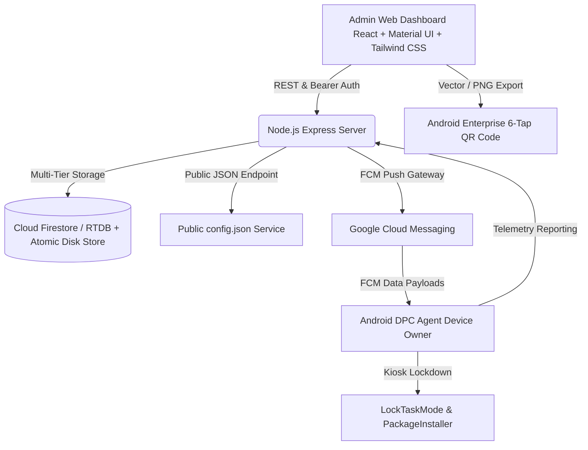

# ApexMDM - Advanced Android Enterprise Control Platform

An enterprise-grade **Mobile Device Management (MDM) & Kiosk Policy Platform** built for corporate Android fleets, dedicated kiosks, warehouse scanners, and field hardware.

---

## 🏛️ System Architecture



### 1. Data Persistence & Cloud Backend (Multi-Tier Zero Data Loss)
- **Tier 1 (Cloud Database)**: Firebase Firestore & Realtime Database synchronization.
- **Tier 2 (Atomic Disk Persistence)**: Committed to `server/data/mdm_database.json` on physical disk on every write mutation, guaranteeing zero data loss across reboots, crashes, and server restarts.
- **Tier 3 (Browser Session Storage)**: LocalStorage synchronization for immediate offline responsiveness.
- **Instant Backup & Restore**: One-click **Export System JSON Backup** (`apex_mdm_backup_<timestamp>.json`) and one-click **Restore from JSON** with drag-and-drop file upload.

---

## 🌟 Modules & Features

### 1. Real-Time Fleet Dashboard & Telemetry
- **Live Device Telemetry**: Real-time Battery % (with AC charging indicator), Available vs Total Storage progress bars, Active Wi-Fi SSID, IP Address, Android Version, and Installed Packages inspector.
- **Remote Action Controls per device**:
  - `Lock Device`: Enforces immediate screen lockdown.
  - `Reset Lock Password`: Remotely sets new screen lock PIN/passcode (`DevicePolicyManager.resetPassword()`).
  - `Silent App Install`: Select an APK from the App Repository and push background install (`PackageInstaller`).
  - `Wipe Device`: Remote factory reset with security confirmation dialog (requires typing "WIPE").
  - `Reboot Device`: Reboots hardware remotely.
  - `Force Telemetry Sync` & `Ping Heartbeat`.
- **Bulk Policy Deployment**:
  - Multi-select checkboxes to select individual or all devices.
  - Floating batch action bar to apply policy profiles in bulk over FCM.

### 2. Enrollment & Onboarding Center (6-Tap QR Code)
- Configurable Android Enterprise Provisioning Parameters:
  - Admin Component Name: `com.example.myapplication/.MDMDeviceAdminReceiver`
  - Direct APK Download URL & SHA-256 Checksum.
  - Staging Wi-Fi Auto-Connect: SSID, Password, Security Type (WPA/WPA2/Open), and Hidden Network flags.
  - Server Base Sync URL and Enterprise Enrollment Token.
- **Interactive QR Code Generator**:
  - Vector SVG & high-res Canvas rendering via `qrcode.react`.
  - **Download PNG** button (for printing technician cards).
  - **Download SVG** button (for posters and hardware packaging).
  - **Copy Raw JSON** button.
  - Integrated **6-Tap Setup Instructions** modal.

### 3. Advanced Policy Profile Editor (`config.json` Generator)
- **Graphical Visual Policy Builder**:
  - **Kiosk Mode Selection**: Toggle between `OFF` (Standard Corporate Launcher), `SINGLE_APP` (Pinned to 1 app), and `MULTI_APP` (Allowlisted icons only).
  - **Allowlisted Packages**: Interactive tag editor to add/remove package names (`dpm.setLockTaskPackages`).
  - **LockTask UI Controls**: Toggles for Home button, Overview/Recents, System Info Bar, Notification shade, and Global Power Actions.
  - **Security Restrictions**: Toggles for `UserManager` policies:
    * Disable Factory Reset (`DISALLOW_FACTORY_RESET`)
    * Disable Safe Boot (`DISALLOW_SAFE_BOOT`)
    * Disable Camera (`DISALLOW_CAMERA`)
    * Disable Screen Capture (`DISALLOW_SCREEN_CAPTURE`)
    * Block USB File Transfer (`DISALLOW_USB_FILE_TRANSFER`)
    * Disable Bluetooth (`DISALLOW_BLUETOOTH`)
    * Disallow Wi-Fi Configuration (`DISALLOW_CONFIG_WIFI`)
    * Disallow Adjusting Volume (`DISALLOW_ADJUST_VOLUME`)
    * Block Unknown Sources (`DISALLOW_INSTALL_UNKNOWN_SOURCES`)
    * Block Adding Multiple Users (`DISALLOW_ADD_USER`)
  - **Mandatory App Silent Distribution**: Select APKs from the repository to automatically install and block deletion.
  - **System Update Policy**: Automatic, Windowed (e.g. 02:00 - 05:00), or Postpone (up to 30 days).
  - **Live `config.json` Preview**: Side-by-side formatted JSON viewer.
  - **"Publish Policy to Cloud"** button: Updates cloud database and serves public endpoint:
    `GET http://localhost:5001/api/policies/:id/config.json`

### 4. Enterprise App Repository
- Manage corporate APK catalog:
  - App Name, Package Name, Version, Size (MB), Category, Download URL, SHA-256 Checksum, and Mandatory status.
  - Register new APK packages.
  - Direct download links and silent push triggers.

### 5. Virtual Android Handset Simulator
- An interactive on-screen smartphone emulator connected via Server-Sent Events (SSE).
- Reflects remote commands (`LOCK`, `UNLOCK`, `PING`, `SYNC`, `RELEASE`) in real-time on a virtual kiosk lock screen.

---

## 🚀 Quick Start Guide

### 1. Run the Backend Server (Port 5001)
```bash
cd server
npm install
node index.js
```

### 2. Run the React Web Dashboard (Port 5173)
```bash
cd client
npm install
npm run dev
```

Visit **`http://localhost:5173`** and click **"Instant Demo Superadmin Login"**.

---

## 📑 API Endpoints Reference

| Method | Endpoint | Description |
|---|---|---|
| `GET` | `/api/policies/:id/config.json` | **PUBLIC**: Standard Android Enterprise JSON schema consumed by DPC clients |
| `POST` | `/api/auth/demo-login` | Authenticate MDM operator session |
| `GET` | `/api/devices` | List all enrolled handsets with live telemetry |
| `POST` | `/api/devices/bulk-policy` | Batch deploy policy profile across selected devices |
| `POST` | `/api/devices/:imei/lock` | Remotely lock handset |
| `POST` | `/api/devices/:imei/unlock` | Remotely unlock handset |
| `POST` | `/api/devices/:imei/reset-password` | Enforce new screen lock passcode |
| `POST` | `/api/devices/:imei/silent-install` | Trigger silent background APK installation |
| `POST` | `/api/devices/:imei/wipe` | Trigger remote factory reset |
| `GET` | `/api/policies` | List all graphical policy profiles |
| `POST` | `/api/policies` | Create or update a policy profile |
| `GET` | `/api/apps` | List enterprise APK repository |
| `POST` | `/api/apps` | Register new APK package in repository |
| `GET` | `/api/enrollment/profile` | Fetch 6-Tap QR code provisioning parameters |
| `POST` | `/api/enrollment/profile` | Update enrollment QR parameters |
| `GET` | `/api/backup/export` | Export full JSON database backup |
| `POST` | `/api/backup/import` | Restore full database from JSON backup file |
